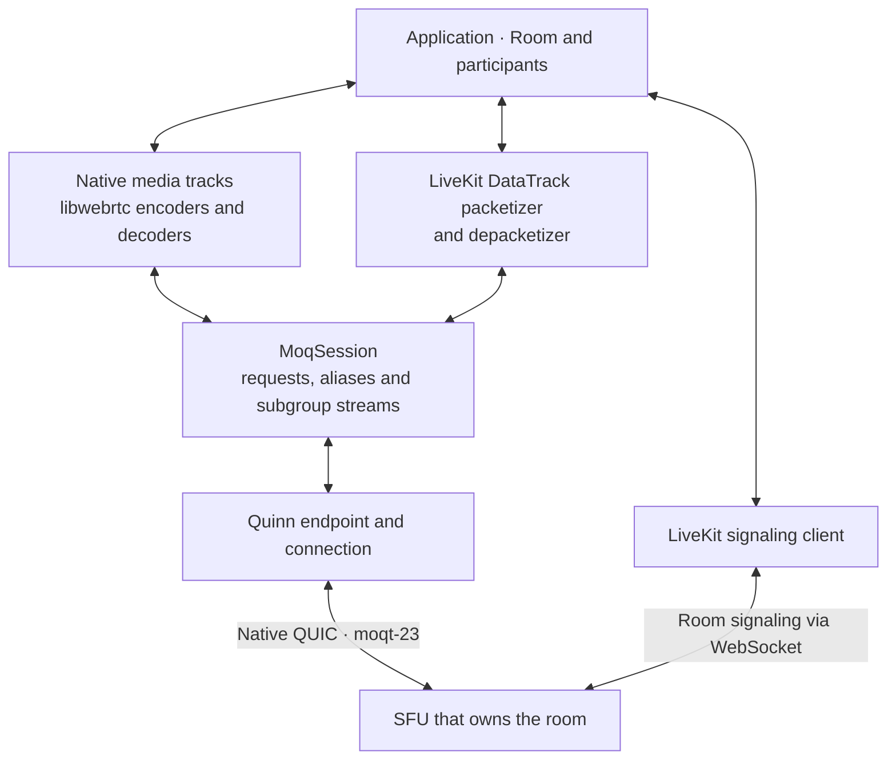
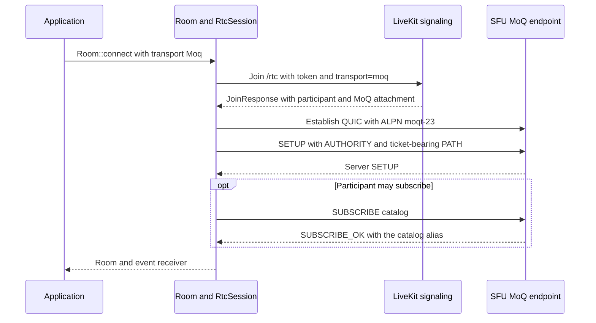

# How the Rust SDK carries room tracks over MoQ

A native desktop or server app selects Media over QUIC (MoQ) once, when it joins a room. The app continues to work with `Room`, media publications, remote tracks and DataTracks. Internally the SDK keeps two connections to LiveKit. A WebSocket handles room membership, permissions and track lifecycle. A native QUIC connection carries encoded media and DataTrack packets. Each participant selects its own transport, so a Rust MoQ publisher can send to a WebRTC subscriber and vice versa.

For the app-visible differences from WebRTC, including all 44 room events, see the [feature parity report](moq-feature-parity.md). For the implementation and shared protocol revision, see the [Rust SDK file-by-file changes](moq-file-changes.md).

## Enable it in an app

Build the `livekit` crate with the `moq` feature. For secure WebSocket signaling, also enable a signaling TLS feature such as `rustls-tls-native-roots`. The examples use Tokio and the `futures-util` stream extension trait. The following helper takes the usual LiveKit base URL and room token. Keep the returned room and consume its event receiver in the application's normal event loop. WebRTC remains the default when the application leaves `transport` unset. [Cargo features](../Cargo.toml) · [Room options](../src/room/mod.rs)

```rust
use livekit::prelude::{Room, RoomEvent, RoomOptions, RoomResult, RoomTransport};
use tokio::sync::mpsc::UnboundedReceiver;

pub async fn join_moq(
    signaling_url: &str,
    token: &str,
) -> RoomResult<(Room, UnboundedReceiver<RoomEvent>)> {
    let mut options = RoomOptions::default();
    options.transport = RoomTransport::Moq;
    Room::connect(signaling_url, token, options).await
}
```

On the SFU, enable `moq.enabled`, configure a node-specific `moq.endpoint` and the shared QUIC listener's TLS certificate. MoQ participants always have DataTracks enabled. The client obtains the QUIC address from signaling. The `signaling_url` above is a URL such as `wss://signal.example.com`. The complete server configuration and third-party subscriber profile are in `docs/moq.md` in the matching LiveKit server checkout.

## Who owns each part



| Component | Responsibility and reason for the dependency |
| --- | --- |
| Quinn 0.11.12 and rustls | The SDK owns the UDP endpoint, verifies the server certificate using the platform verifier, and selects TLS 1.3 and ALPN `moqt-23`. Quinn's Tokio integration and `Endpoint::rebind` let the SDK move this same live connection to a new local address. [Connection setup](../src/rtc_engine/moq.rs) · [Quinn rebind API](https://docs.rs/quinn/0.11.12/quinn/struct.Endpoint.html#method.rebind) |
| moqtap-client 0.16.0 and moqtap-codec 0.13.1 | The client can **adopt an already-connected Quinn connection**. It runs draft-23 SETUP, requests and control dispatch. The codec supplies subgroup headers, objects, variable-length integers and property parsing. This lets the SDK use its own TLS policy, bounded queues and media workers on one connection. Both crates are pinned with their `draft23` feature. [Session implementation](../src/rtc_engine/moq.rs) · [Dependency pins](../Cargo.toml) |
| libwebrtc and livekit-datatrack | Standalone encoders and decoders connect native capture and playback to MoQ objects. The DataTrack crate handles logical tracks, handles and frame fragmentation. These components preserve the existing application APIs across transports. [Media adapter](../src/rtc_engine/moq/media.rs) · [DataTrack crate](../../livekit-datatrack/README.md) |
| quic-go 0.64.1 and Trickster 2.2.2 on the SFU | The server already uses quic-go for its HTTP/3 listener. ALPN sends native MoQ connections on that same UDP port to Trickster's draft-23 session handler. Its SETUP callback binds the session to a LiveKit participant. The Go and Rust implementations are exercised against each other. The Trickster release requires Go 1.27.4 for source builds. |

The integration targets the specific profile `livekit-moq-2;moqt=23`. Transport messages follow MOQT draft 23, the media catalog uses MSF draft 02, and encoded samples use LOC draft 05. These wire revisions are part of the compatibility contract when upgrading either implementation. [MOQT draft 23](https://datatracker.ietf.org/doc/html/draft-ietf-moq-transport-23) · [MSF draft 02](https://datatracker.ietf.org/doc/html/draft-ietf-moq-msf-02) · [LOC draft 05](https://datatracker.ietf.org/doc/html/draft-ietf-moq-loc-05)

## From room join to a live session



1. **Select the signaling path.** `Room::connect` sets `use_moq` and uses the existing `/rtc` WebSocket join with `transport=moq`. Tracks supplied at connect time go through the regular publish path after the join. Room E2EE is rejected for this profile. [Room join](../src/room/mod.rs) · [Signaling URL construction](../../livekit-signaling/src/lib.rs)
2. **Verify the attachment.** `RtcSession` passes the join response and connect timeout to `MoqSession::from_join`. It checks the advertised profile, namespace prefix, participant SID, endpoint shape and presence of an attachment token. It resolves the node, establishes QUIC, and hands the connected transport to moqtap. A missing or invalid attachment fails the requested join. [Attachment and dial](../src/rtc_engine/moq.rs)
3. **Bind to the signaled participant.** SETUP carries the endpoint's host and port in `AUTHORITY`. Its `PATH` is `/moq` with URL-encoded `room`, `sid`, `generation` and `ticket` values from the join. The SFU consumes the short-lived ticket. Keep the token and assembled path out of logs. All MoQ requests use the two-element namespace `("livekit", own_participant_sid)`.
4. **Start the workers.** A participant with subscribe permission opens the catalog at join. Each DataTrack request follows its signaling response. `RtcSession` then runs one `MoqSession` task for that attachment. It multiplexes commands, incoming datagrams, subgroup streams and MoQ control messages. A Tokio `JoinSet` owns its encoders, decoders and route monitor. Later permission updates arrive over the WebSocket and adjust the active requests. [RTC session](../src/rtc_engine/rtc_session.rs) · [MoQ task](../src/rtc_engine/moq.rs)

MoQ rooms retain one idle publisher peer connection for the existing public `RtcSession::publisher()` accessor. They skip the subscriber peer connection, SDP negotiation, SCTP channels and WebRTC event tasks. Quinn carries the media and DataTrack payloads. Standalone libwebrtc codecs encode and decode the media. [RTC session construction](../src/rtc_engine/rtc_session.rs)

## Follow a video frame

**Publish.** The example accepts a camera track the app already created. Keep the returned publication and DataTrack handles for subsequent updates and sends.

```rust
use livekit::{
    options::VideoCodec,
    prelude::{LocalDataTrack, LocalTrack, LocalTrackPublication, LocalVideoTrack, TrackPublishOptions},
};

pub async fn publish_camera_and_data(
    room: &livekit::prelude::Room,
    camera: LocalVideoTrack,
) -> Result<(LocalTrackPublication, LocalDataTrack), Box<dyn std::error::Error>> {
    let participant = room.local_participant();
    let video = participant.publish_track(
        LocalTrack::Video(camera),
        TrackPublishOptions { video_codec: VideoCodec::VP8, ..Default::default() },
    ).await?;
    let telemetry = participant.publish_data_track("telemetry").await?;
    telemetry.try_push(vec![1_u8, 2, 3].into())?;
    Ok((video, telemetry))
}
```

1. `LocalParticipant::publish_track` selects the codec and sends LiveKit `AddTrack` over the WebSocket. The reply assigns the track SID. The SDK publishes one rendition, disables simulcast and RED, and rejects RTP packet-trailer metadata. If the MoQ publish step fails, it requests cleanup of the signaled track. [Local participant](../src/room/participant/local_participant.rs)
2. `MoqSession` allocates an upload alias below 2³¹ and sends `PUBLISH up/<track SID>/<codec>` in the publisher's own namespace. After `REQUEST_OK`, the session keeps the request stream open while the encoder reads frames from `NativeVideoStream`. Unpublishing stops the encoder and cancels the request in both moqtap and QUIC. Supported video codecs are H.264, H.265, VP8, VP9 and AV1, subject to the native build and the host's codec capabilities. [Publication and alias allocation](../src/rtc_engine/moq.rs) · [Native codec bindings](../../libwebrtc/src/native/video_codec.rs)
3. Each encoded access unit becomes one LOC object with a microsecond timestamp and video frame marking. A keyframe opens a new group on subgroup zero. Delta frames continue on that same unidirectional QUIC stream with consecutive object IDs. The encoder requests a keyframe periodically while frames arrive. Opus follows the same publication path, with one packet per group. [Media writer](../src/rtc_engine/moq/media.rs)

**Receive.** The SFU sends full catalog snapshots on the subscriber's own `catalog` subscription. The SDK processes newer snapshots, removes workers for renditions that disappear, and subscribes to supported LOC entries by their exact catalog names. For example, a WebRTC publisher's `TR_camera/vp8` is subscribed to in the **reader's** namespace. The Rust room adapter uses `livekit.sid` and `livekit.publisherSid` from the catalog to associate decoded media with the signaled participant and publication. If media arrives first, the room holds the track until its signaling metadata arrives. A catalog withdrawal or revoked subscribe grant clears the pending or attached track. Restoring permission opens fresh media requests and emits the normal subscription event. An independent reader can select the rendition using standard catalog fields. [Catalog reconciliation](../src/rtc_engine/moq.rs)

Downstream, the SFU sends one object per subgroup stream. The SDK routes it by the alias returned in `SUBSCRIBE_OK`. The decoder starts video on object zero of a keyframe group, checks group and object continuity before feeding delta frames, and delivers decoded frames to a `NativeVideoSource`. The room attaches the resulting media track to the remote publication and emits the usual `RoomEvent::TrackSubscribed`. Applications can read frames through `NativeVideoStream`. [Decoder](../src/rtc_engine/moq/media.rs) · [Remote publication attachment](../src/room/participant/remote_participant.rs)

## Follow a DataTrack frame

A named application track such as `telemetry` has a LiveKit track SID and handle. Each logical publication has its own MoQ alias in each direction on the room connection. Creating a DataTrack, announcing it, subscribing to it and assigning handles use WebSocket signaling. The packet payloads take these paths. [DataTrack crate](../../livekit-datatrack/README.md) · [RTC session event routing](../src/rtc_engine/rtc_session.rs)

| Direction | How one application frame travels |
| --- | --- |
| App → SFU via `dt/up/<SID>` | After the server accepts the alias, `try_push` feeds the existing LiveKit packetizer. The queue retains the freshest pending frame for each publication. Each serialized packet gets one group. Object IDs start at zero. Each chunk travels in a QUIC DATAGRAM, with END_OF_GROUP on the last chunk. |
| SFU → app via `dt/down/<SID>` | The SDK subscribes per signaled handle, validates the alias and packet handle, and sends complete packets to the shared DataTrack depacketizer. A lost chunk can cost a frame. Later complete packets continue without waiting for repair. |

A successful `try_push` reports local acceptance. Observe remote delivery on the receiving frame stream. Under backpressure an older pending frame can be dropped as a unit. The media catalog carries audio and video renditions. DataTrack discovery comes from LiveKit signaling. RPC, legacy data packets, and text or byte streams are outside this transport profile. [Send queue](../src/rtc_engine/dc_sender.rs) · [MoQ datagram framing](../src/rtc_engine/moq/datatrack.rs)

For example, pass the remote track from `RoomEvent::DataTrackPublished` to a worker. This helper returns the first complete payload, or `None` when the stream ends.

```rust
use futures_util::StreamExt;
use livekit::prelude::{DataTrackSubscribeError, RemoteDataTrack};

pub async fn first_payload(
    track: &RemoteDataTrack,
) -> Result<Option<Vec<u8>>, DataTrackSubscribeError> {
    let mut frames = track.subscribe().await?;
    Ok(frames.next().await.map(|frame| frame.payload().to_vec()))
}
```

A publisher can start capture on `LocalTrackSubscribed` when its first visible MoQ viewer attaches. Viewers receive speaker and connection quality updates for subscribed publishers. A rejected advertised rendition produces `TrackSubscriptionFailed` with the publisher, track SID and reason. A failed decoder closes its own subscription. The next catalog update can retry the track while the room stays connected. [Event parity report](moq-feature-parity.md)

## Handoff, failure and resource bounds

| Event | SDK behavior |
| --- | --- |
| Wi-Fi changes to cellular while the QUIC attachment is live | Every 500 ms a worker checks the local source address the OS selects for the connected SFU. When the route changes or returns after a gap, it rebinds the room's Quinn endpoint. The existing requests and subscriptions continue on that connection if the same SFU address remains reachable in time. Delivery may pause during path validation and retransmission. This path needs no new handshake or MoQ publication. |
| The signaling WebSocket breaks | The engine can resume signaling while preserving the live QUIC attachment and publications. |
| QUIC closes, the server sends GOAWAY, or a fatal session error occurs | The MoQ task closes the connection, shuts down its workers and asks the engine for a full reconnect. A successful rejoin provides a fresh ticket. Local media tracks can be republished with new SIDs, and the room emits `LocalTrackRepublished` for a successful media republish. Full reconnect uses ordinary QUIC setup. |
| The app closes the room | The close signal stops the MoQ task and its workers. Intentional shutdown suppresses the transport-reconnect event. |

The client bounds work per connection. It reads up to 16 subgroup streams concurrently, caps a media payload at 4 MiB, a catalog at 256 KiB and a DataTrack packet at 64 KiB. Each decoder queue holds eight samples. Each DataTrack alias retains a window of 16 groups, with at most 64 chunks of 1024 bytes per group. The current media publication request deadline is three seconds and stream I/O has a 15-second deadline. These are internal limits. A media payload timeout after its alias is known can drop that object. [Session limits and teardown](../src/rtc_engine/moq.rs) · [Network route monitor](../src/rtc_engine/moq/network.rs) · [Room reconnect handling](../src/room/mod.rs)

## Verify an integration

From the Rust SDK workspace, set `LIVEKIT_URL`, `LIVEKIT_API_KEY` and `LIVEKIT_API_SECRET` for a test SFU configured for MoQ and DataTracks. For a local QUIC test CA, set `LIVEKIT_MOQ_TEST_CA_DER` to its DER certificate path in the e2e build.

```sh
cargo test --locked -p livekit \
  --features moq,__lk-e2e-test,rustls-tls-native-roots \
  --test moq_test -- --ignored
```

The suite exercises WebRTC → MoQ, MoQ → WebRTC and MoQ → MoQ using decoded video for all five codecs, Opus and a fragmented 128 KiB DataTrack frame. It also checks permission changes, full reconnect, and an independent moqtap subscriber that consumes a VP8 keyframe after LiveKit signaling. The handoff case keeps the original subscriptions across socket changes. Set `LIVEKIT_MOQ_TEST_HANDOFF_IP` to a second reachable local IP to exercise an address change. The SFU's `test/moq/README.md` describes the optional two-second packet-loss relay. This is a local simulation of handoff. [Room interoperability tests](../tests/moq_test.rs)
